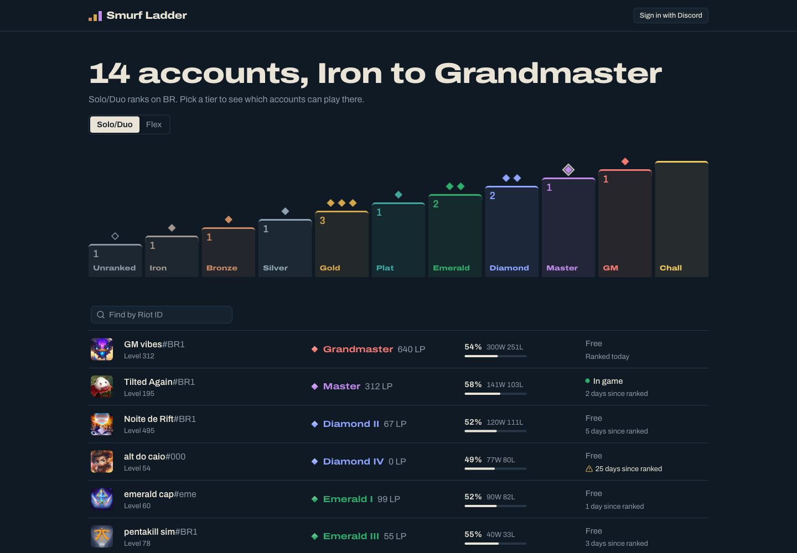
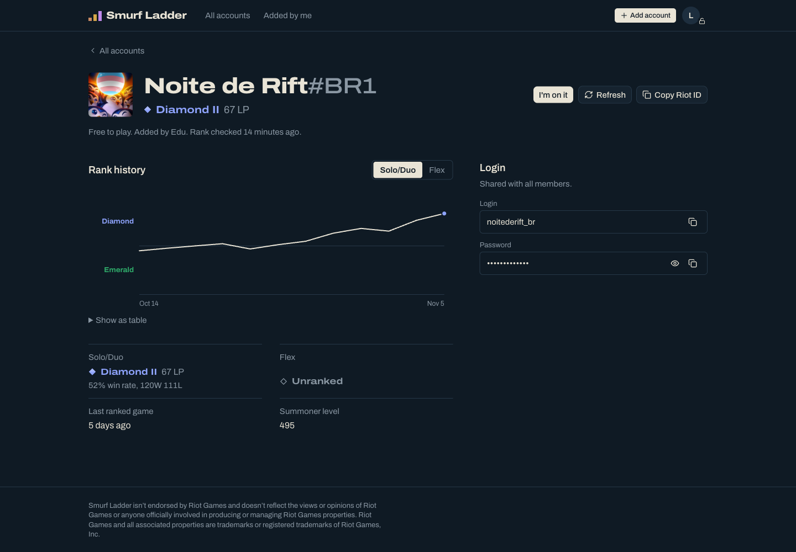

# Smurf Ladder

Every League of Legends account your group shares, on one ladder. Pick a tier and see which accounts can play there. No more logging in to each one to check its rank.



- **The ladder.** Every account is pinned on its tier, from Iron to Challenger, for Solo/Duo or Flex. Click a tier to filter.
- **Live status.** Ranks, win rates and "in game now" refresh automatically every few minutes. Members can mark an account "I'm on it" so nobody else logs in at the same time.
- **Rank history.** Each account keeps a chart of its LP over time.
- **Decay warning.** Diamond+ accounts that haven't played ranked in 21 days get flagged.
- **End-to-end encrypted logins.** Each account can store its login. You choose whether it's shared with every member or private to you. Logins are encrypted in the browser, and the server only ever holds ciphertext.
- **Members only.** Members sign in with Discord and must be on an allowlist. Anyone can see the public ladder (Riot ID and rank). Owners, claims and logins are visible to members only.

It runs entirely on Cloudflare's free plan (Workers, D1, Cron Triggers) and the free Riot API.



## Stack

[TanStack Start](https://tanstack.com/start) (React, SSR, server functions) · Tailwind CSS v4 + shadcn/ui · Cloudflare Workers via `@cloudflare/vite-plugin` · D1 + Drizzle ORM · Discord OAuth via [arctic](https://arcticjs.dev) · WebCrypto for the vault.

## How the vault works

```
passphrase ──PBKDF2 (600k)──▶ key-encryption key ──wraps──▶ your RSA-OAEP private key
your public key ──wraps──▶ group AES-256 key ──encrypts──▶ shared logins
your public key ──wraps──▶ per-item AES key   ──encrypts──▶ your private logins
```

- Each member chooses a **vault passphrase** (separate from Discord). Their browser generates an RSA-OAEP-3072 keypair and seals the private key with a key derived from the passphrase. The server stores only the public key and the sealed private key.
- **Shared logins** are encrypted with one group key. The first member to set up a vault creates it. New members appear as *waiting*. An existing member compares the newcomer's **key fingerprint** over Discord, then approves them, which wraps the group key to the newcomer's public key. The fingerprint check means a compromised server can't sneak in its own key.
- **Private logins** get a fresh key wrapped only to their owner.
- **Removing a member** rotates the group key. The admin's browser re-encrypts every shared login under a new key and grants it to everyone who stays.
- **"Remember this device"** keeps your private key in IndexedDB as a *non-extractable* CryptoKey. The page can use it, but can't read its bytes out.

**What it protects against:** a leaked database, a curious Cloudflare account holder, someone reading the Worker's logs. **What it doesn't:** a malicious deployment of the site's own JavaScript (as with any web-based vault), or a member who already saw a password before being removed. Change those Riot passwords if that matters. **A forgotten passphrase** means your private logins are gone for good. Shared ones can be re-granted by another member after you set up a new vault.

## Self-hosting

You need a Cloudflare account, a Discord application and a Riot API key. All three are free.

1. **Riot API key.** Sign in at [developer.riotgames.com](https://developer.riotgames.com). The development key works right away but expires every 24 hours. For a group of friends, register a *Personal API Key* (it doesn't expire).
2. **Discord app.** In the [Discord developer portal](https://discord.com/developers/applications), create an application. Under OAuth2, add the redirect `https://<your-domain>/auth/discord/callback` (and `http://localhost:5173/auth/discord/callback` for local dev). Copy the client ID and secret.
3. **Your Discord user ID.** Turn on Developer Mode in Discord, then right-click yourself and choose *Copy User ID*. This account becomes the first admin.
4. **Install and configure:**

   ```sh
   pnpm install
   pnpm wrangler d1 create smurf-ladder   # paste the database_id into wrangler.jsonc
   pnpm db:migrate:remote
   pnpm wrangler secret put RIOT_API_KEY
   pnpm wrangler secret put DISCORD_CLIENT_ID
   pnpm wrangler secret put DISCORD_CLIENT_SECRET
   pnpm wrangler secret put ADMIN_DISCORD_ID
   pnpm run deploy
   ```

5. Sign in, set up your vault, then invite friends from **Members** by their Discord user IDs.

The region is BR by default. For another server, change `RIOT_PLATFORM` (e.g. `euw1`, `na1`) and `RIOT_REGION` (`europe`, `americas`, `asia`) in `wrangler.jsonc`.

### Local development

```sh
cp .dev.vars.example .dev.vars   # fill in the values
pnpm db:migrate:local
pnpm dev                          # http://localhost:5173
pnpm test                         # vault crypto + rank logic
```

To run the refresh job locally: `curl -X POST "http://localhost:5173/cdn-cgi/local/explorer/api/local/scheduled?worker=smurf-ladder" -d '{"cron":"*/5 * * * *"}'`.

### Free-tier budget

The cron runs every 5 minutes and refreshes the 9 stalest accounts. That's 3–5 Riot calls each, which stays under the free plan's 50 outbound requests per run and Riot's 100 requests per 2 minutes. At that rate, 50 accounts cycle in about 25 minutes. Rank snapshots are written only when something changed.

## Legal

Smurf Ladder isn't endorsed by Riot Games and doesn't reflect the views or opinions of Riot Games or anyone officially involved in producing or managing Riot Games properties. Riot Games and all associated properties are trademarks or registered trademarks of Riot Games, Inc.

Sharing accounts is against Riot's Terms of Service. This project tracks ranks of accounts you own. What you do with the vault is up to you.

MIT licensed.
